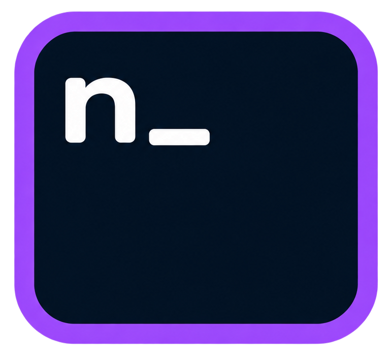
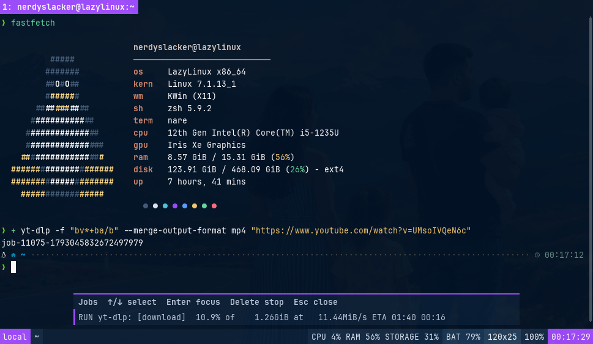

<div align="center">
<a href="https://github.com/nerdyslacker/nare"></a>
</div>
<h1 align="center">nare terminal</h1>
<div align="center">

[](https://github.com/nerdyslacker/nare/blob/main/LICENSE)
[](https://github.com/nerdyslacker/nare/releases)
<a href="https://app.commanddash.io/agent?github=https://github.com/nerdyslacker/nare"></a>
[](https://github.com/nerdyslacker/nare/stargazers)
[](https://github.com/nerdyslacker/nare/fork)

</div>

`nare` pronounced nah-reh (/nɑːrɛ/) is an experimental X11-only terminal emulator written in Odin.

<div align="center">
    
</div>

## Features

- Native VT parser with Unicode, true color, alternate screens, synchronized updates, mouse, focus, and bracketed paste.
- Fontconfig, FreeType, and HarfBuzz rendering with font fallback, combining and wide characters, color glyphs, and configurable ligatures.
- Automatic OpenGL rendering with CPU fallback and a separate CPU-only build.
- Native tabs and split/stack pane layouts, named command bindings with focus-or-create rules, configurable font zoom, optional close confirmation, and a red tab warning for root foreground sessions.
- Automatic tmux `-CC` detection with native window tabs and split-pane views, local/SSH profiles, bounded reconnect, external-state reconciliation, and detach/restoration.
- Bounded, resize-reflowing scrollback with incremental search, smooth wheel navigation, and a draggable scrollbar.
- X11 PRIMARY and CLIPBOARD selection, bracketed paste, large INCR transfers, OSC 8 links, and keyboard URL hints.
- Kitty Graphics, Sixel, and iTerm2 inline images with scaling, transparency, clipping, scrolling, and CPU/GPU composition.
- OSC 0/2/7/8/52/133 and XTGETTCAP support, including prompt navigation and command-output copy or piping.
- Runtime configuration, bounded image and transfer resources, and bundled terminfo.
- Optional local server/client mode with isolated windows, bounded authenticated IPC, and waiting or detached client launches.
- Optional X11 drop-down mode with monitor-relative geometry and same-user command forwarding.
- Optional native status bar with local/tmux metadata, tracked command jobs, system resources, foreground command, Git state, and current zoom percentage.

## Dependencies

Void Linux and LazyLinux use the same XBPS packages:

```sh
sudo xbps-install -S base-devel libX11-devel libXext-devel libXrandr-devel fontconfig-devel freetype-devel harfbuzz-devel libglvnd-devel ncurses
```

Install Odin `dev-2026-10` separately and make sure `odin` is in `PATH`.

The binary requires `libX11 libXext libXrandr fontconfig freetype libharfbuzz libglvnd`. A usable font is required (`dejavu-fonts-ttf` is a small default); install `noto-fonts-emoji` for color emoji. `xdg-utils` enables the default URL opener, and `git` optionally enables complete status-bar repository state detection.

Build and run:

```sh
make
./build/nare
```

`nare` uses OpenGL when available and falls back to CPU rendering. `make build-lite` builds the optional no-OpenGL `build/nare-lite` binary.

Configuration is loaded from `$XDG_CONFIG_HOME/nare/nare.conf`, or `~/.config/nare/nare.conf`. Copy [nare.conf](nare.conf) as a starting point; command-line options override it.

Split configuration with repeatable `include=` directives. Relative paths are resolved from the file containing the directive, nested includes are supported, and later values override earlier ones:

```ini
include=bindings.conf
include=themes/catppuccin-mocha.conf
```

`include=` is independent of sections and may appear anywhere. Included files use the normal section syntax, for example `[bindings]` in `bindings.conf` or `[colors]` in a theme file. Absolute and `~/...` paths are also accepted. Include a theme before local `[colors]` to use it as a base with local overrides, or after `[colors]` to let the theme override them. Complete Catppuccin Mocha and Latte themes are bundled under `themes/`.

`nare-lite` keeps an independent profile under `$XDG_CONFIG_HOME/nare-lite/nare.conf`, or `~/.config/nare-lite/nare.conf`.

Normal-window startup dimensions use `[window] width` and `height`. Set `remember-size=yes` to restore the last manually resized, non-maximized window; saved dimensions use the matching `nare` or `nare-lite` directory under `$XDG_STATE_HOME`, or `~/.local/state`.

After editing `nare.conf`, press `Alt+Shift+R` to reload it. Invalid changes are reported without replacing the running configuration; customize the shortcut with `reload-config` under `[bindings]`.

Set `[shell] startup-command=/usr/bin/fish --login` to replace the default `$SHELL` command for local tabs and panes. Explicit `-e COMMAND [ARG...]` launches still override it.

Run `nare /path/to/folder` to open a shell in that folder. `make install` also installs the desktop entry used by file managers for **Open with nare**.

## Background jobs

Initialize the `+` command once in your shell:

```sh
# bash (.bashrc)
eval "$(nare job init bash)"

# zsh (.zshrc)
eval "$(nare job init zsh)"

# fish (config.fish)
nare job init fish | source
```

Use `+ make` to run and track a command in the background, or `+ +build make` to give it the label `build`. The prompt returns immediately; click the jobs module or press `Alt+Shift+J` to open the jobs popup. The popup shows each job's latest output line; use Up/Down to select, Enter to focus its originating pane, Delete to interrupt it, and Escape to close. Repeated Delete presses escalate from `SIGINT` to `SIGTERM` and then `SIGKILL`.

The equivalent direct command is `nare job run build -- make`. Scripts may report progress with `nare status job start|progress|finish|fail`. Tracking is scoped to the originating nare window and does not inspect unrelated processes.

## Server mode

Server mode is optional; ordinary `nare` launches remain standalone and never contact a daemon.

```sh
nare --server
nare --client
nare --client -e htop
nare --client --no-wait /path/to/project
nare --client --font-size=18 --ligatures=false --title=work
```

By default the private socket is `$XDG_RUNTIME_DIR/nare.sock`. Both endpoints verify same-user peer credentials. `--server-socket=PATH` selects an explicit path for supervised or test setups.

The server owns all X11 windows, PTYs, terminal state, and rendering. A waiting client exits with its terminal child's status; disconnecting that client closes its associated window. `--no-wait` transfers the window lifetime to the server after creation. A server crash or shutdown closes every server-owned window and session; this mode does not promise persistence or reconnection.

An explicitly launched server stays alive when its last window closes. Stop it with `SIGINT` or `SIGTERM`; service managers may impose a different lifetime policy.

The server's configuration supplies window defaults. Clients may explicitly override font size, renderer, ligatures, and title with their normal command-line flags; other appearance settings remain server-owned. Panes and simultaneous server windows at the same font size share font faces, shaping resources, and the bounded glyph cache, while each pane keeps independent CPU/GPU and X11 renderer state.

## Quake mode

Quake mode is a special top-level window around the normal nare workspace. Hiding it does not close PTYs, discard tabs or scrollback, or detach native tmux control-mode sessions.

```sh
nare --quake          # toggle an existing instance, or start one visible
```

The private Unix socket is scoped to the current UID and `DISPLAY`, uses peer-credential checks, and exists only while the quake GUI runs. Configuration lives under `[quake]` in `nare.conf`. `monitor` accepts `focused`, `primary`, or an XRandR output name; a missing output falls back to the primary output and then the first connected output. Geometry honors EWMH docks and taskbar struts from any desktop environment or window manager, is clamped to the selected monitor, and refreshes after output changes.

Nare does not install a focused-window Quake binding. For a global X11 shortcut, use an external hotkey daemon such as sxhkd:

```text
alt + grave
    nare --quake
```
